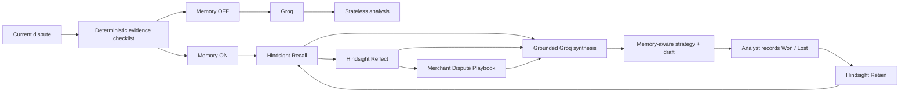

# Dispute Ledger

**Every resolved case should make the next response easier.**

[Live demo](https://dispute-ledger-inky.vercel.app) · [Golden demo: DL-2048](https://dispute-ledger-inky.vercel.app/disputes/DL-2048) · [Merchant memory](https://dispute-ledger-inky.vercel.app/memory)

If a team has already handled 30 disputes, case 31 should not feel like case 1. That is the whole idea behind Dispute Ledger.

Dispute Ledger is a chargeback-response workspace that keeps useful experience from resolved disputes and brings it back when a similar case appears. It remembers what evidence was available, what strategy was used, whether the case was won or lost, and the lesson worth carrying forward.

The memory layer is powered by [Hindsight](https://github.com/vectorize-io/hindsight). Groq is used for the final analysis and wording.

> The live demo is already configured on Vercel. You do **not** need API keys to try it. API keys are only required if you clone the project and run your own copy.

---

## The problem I wanted to solve

Chargeback work is repetitive, but the learning is easy to lose.

An analyst may discover that a tracking screenshot alone was weak in one case, or that a post-delivery support message was much more useful in another. A normal stateless LLM does not know any of that the next time a dispute arrives. It sees the new case and starts again.

Dispute Ledger turns resolved cases into reusable merchant memory.

For a new dispute it can:

- inspect the current case and its available evidence;
- recall similar resolved disputes from Hindsight;
- reflect across those cases for recurring patterns and caveats;
- show which historical cases influenced the recommendation;
- generate a response grounded only in the current case's evidence; and
- retain the new Won/Lost outcome so it can help with future cases.

Historical cases guide the strategy. They are **not** treated as evidence for the current dispute.

---

## Try the 60-second demo

The easiest place to start is **DL-2048**, a synthetic "product not received" dispute for a $499 monitor.

1. Open the [DL-2048 workspace](https://dispute-ledger-inky.vercel.app/disputes/DL-2048).
2. Run **Memory OFF** first. This is the stateless baseline: current case + deterministic evidence checklist + Groq.
3. Switch to **Memory ON — Hindsight**.
4. Run the analysis again. Hindsight recalls relevant resolved cases such as DL-1107, DL-1089 and DL-1142, then reflects across merchant history.
5. Compare the evidence priority. The memory-aware path can surface the customer's post-delivery "How do I enable 144 Hz?" support message as useful possession context, while also showing why tracking-only precedent was weak in this synthetic merchant history.
6. Record a Won/Lost outcome. The outcome is retained back into Hindsight as a new learning event.
7. Open [Merchant Memory](https://dispute-ledger-inky.vercel.app/memory) to search the memory bank or inspect the Merchant Dispute Playbook.

The point of the demo is not that the model changed. The current case and Groq model stay the same. The meaningful difference is whether the analysis has access to the merchant's resolved experience.

---

## One design choice that matters

I deliberately kept the evidence checklist deterministic instead of asking the LLM to decide what evidence exists.

An LLM can help explain or organize a case. It should not invent a signed receipt, delivery photo, tracking event, or customer message that was never provided.

That gives the application a simple boundary:

- **current-case facts** can be used in the representment draft;
- **historical memories** can influence strategy and prioritization;
- missing evidence stays missing.

This is also why the interface shows the Memory Trace instead of hiding the memory step behind a generic chat box.

---

## How the memory loop works



### What Hindsight is doing here

| Hindsight operation | Used for |
|---|---|
| **Retain** | Store the 30 resolved seed cases and every newly recorded outcome |
| **Recall** | Retrieve semantically similar resolved disputes for a new case |
| **Reflect** | Synthesize patterns, failed approaches, useful evidence combinations and caveats |
| **Mental Model** | Maintain the **Merchant Dispute Playbook**, a reusable view of merchant-wide lessons |

This is intentionally different from using memory as a transcript archive. The application is trying to remember **what happened, what was tried, and how it turned out**.

---

## Golden case: DL-2048

DL-2048 is the main demonstration case in this repository.

**Current-case evidence includes:**

- order confirmation;
- carrier delivered scan;
- GPS delivery-location match;
- billing/shipping address match; and
- a post-delivery support interaction two days after delivery.

**Intentionally missing:**

- signed delivery receipt;
- delivery photograph.

The synthetic history contains both wins and losses for similar disputes. That gives the Memory ON path something useful to reason over instead of simply retrieving documents that repeat the current case.

---

## Tech, without the buzzwords

| Part | What it does |
|---|---|
| **Next.js 16 + React + TypeScript** | UI and server routes |
| **Hindsight Cloud** | Persistent merchant memory, recall, reflection and mental model |
| **Groq** | Baseline generation and grounded final synthesis |
| **Zod** | Request/response validation |
| **Vercel** | Production deployment |
| **Static synthetic dataset** | Reproducible demo cases and deterministic evidence rules |

There is no separate application database in this demo. The fixed dispute dataset lives in the repository; Hindsight is the persistent memory layer.

---

## Run it locally

### Requirements

- Node.js **20.9+**
- a Hindsight Cloud API key
- a Groq API key

Clone the repository:

```bash
git clone https://github.com/Koushik-026/dispute-ledger.git
cd dispute-ledger
npm install
```

Create your local environment file:

```bash
cp .env.example .env.local
```

PowerShell:

```powershell
Copy-Item .env.example .env.local
```

Then edit `.env.local` and add **your own** credentials.

```env
HINDSIGHT_API_KEY=your_hindsight_api_key_here
HINDSIGHT_BANK_ID=dispute-ledger-demo
HINDSIGHT_BASE_URL=https://api.hindsight.vectorize.io

GROQ_API_KEY=your_groq_api_key_here
GROQ_MODEL=openai/gpt-oss-120b

NEXT_PUBLIC_DEMO_DATASET=true
```

Seed the demo memory bank:

```bash
npm run seed:hindsight
```

Verify the bank, golden recall, mental model and Reflect operation:

```bash
npm run verify:hindsight
```

Start the app:

```bash
npm run dev
```

Then open [http://localhost:3000](http://localhost:3000).

### About API keys

The production demo uses server-side environment variables configured in Vercel. Visitors to the live site do not receive those keys and do not need to provide their own.

For local development, use your own Hindsight and Groq credentials. Real secrets should go only in `.env.local`; that file is ignored by Git.

---

## Environment variables

| Variable | Required locally | Notes |
|---|---:|---|
| `HINDSIGHT_API_KEY` | Yes | Hindsight Cloud credential |
| `HINDSIGHT_BANK_ID` | No | Defaults to `dispute-ledger-demo` |
| `HINDSIGHT_BASE_URL` | No | Defaults to `https://api.hindsight.vectorize.io` |
| `GROQ_API_KEY` | Yes | Groq server-side credential |
| `GROQ_MODEL` | No | Defaults to `openai/gpt-oss-120b`; code has a fallback model if unavailable |
| `NEXT_PUBLIC_DEMO_DATASET` | No | Keeps the synthetic/demo label visible |

Only `NEXT_PUBLIC_DEMO_DATASET` is intended to be public. Never put Hindsight or Groq secrets in a `NEXT_PUBLIC_*` variable.

---

## Useful scripts

| Command | Purpose |
|---|---|
| `npm run dev` | Start the local Next.js server |
| `npm run build` | Create a production build |
| `npm run lint` | Run ESLint |
| `npm run seed:hindsight` | Seed the 30 resolved disputes and create the playbook mental model |
| `npm run verify:hindsight` | Check bank reachability, golden recall, playbook and Reflect |

For an additional TypeScript check:

```bash
npx tsc --noEmit
```

---

## Repository map

```text
app/
  api/
    analyze/
      baseline/route.ts    # Memory OFF
      memory/route.ts      # Memory ON
    memory/search/route.ts
    outcomes/route.ts      # Retain learning events
    playbook/route.ts      # Mental model read/refresh
    health/route.ts
  disputes/[id]/page.tsx
  memory/page.tsx
  page.tsx

lib/
  demo-data.ts             # 30 resolved + open synthetic cases
  evidence-rules.ts        # deterministic evidence checklist
  hindsight.ts             # Hindsight integration
  groq.ts                  # Groq integration
  prompts.ts               # grounding and analysis prompts
  schemas.ts

scripts/
  seed-hindsight.ts
  verify-hindsight.ts
```

---

## Safety and grounding rules

The app is intentionally conservative about what it calls evidence.

- It never treats a previous dispute as proof for the current dispute.
- It should never invent an unavailable document or event.
- It avoids unsupported "chance of winning" predictions.
- Hindsight history is presented as merchant precedent, not issuer policy.
- The workflow stops at decision support; it does not automatically submit anything to a bank, processor, Visa or Mastercard.

If Hindsight is unavailable, the Memory ON path reports that failure instead of pretending a memory lookup succeeded.

---

## Demo data

Everything in the included dataset is fictional: merchant cases, customers, issuers, products, amounts, outcomes and timelines.

The repository contains 30 resolved synthetic disputes plus open cases used by the UI. The data is fixed rather than generated at runtime so the demo is reproducible.

---

## What this is — and what it is not

Dispute Ledger is a working prototype for a memory-aware chargeback workflow.

It is **not** a production dispute processor, legal advice, an issuer integration, or an autonomous submission system. A production version would still need authentication, tenant isolation, real processor integrations, audit controls, security review and handling for real customer data.

For this project I kept the scope smaller on purpose: one workflow, visible memory, a reproducible dataset, and a clear before/after comparison.

----

## Live links

- **App:** https://dispute-ledger-inky.vercel.app
- **Golden demo:** https://dispute-ledger-inky.vercel.app/disputes/DL-2048
- **Merchant Memory:** https://dispute-ledger-inky.vercel.app/memory
- **Hindsight:** https://github.com/vectorize-io/hindsight

