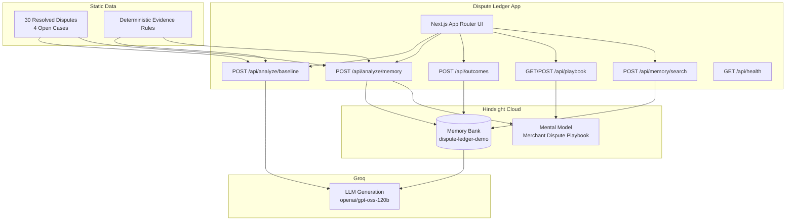

# Dispute Ledger

> **Every resolved case makes the next response stronger.**

Dispute Ledger is a merchant chargeback-response workspace that uses **Hindsight Cloud** as its central long-term memory layer. It remembers every resolved dispute, recalls semantically similar cases for a new dispute, reflects across merchant history to surface patterns, shows the source cases behind its recommendations, and retains new outcomes so future case strategy continuously improves.

---

## Problem Statement

Merchants fighting chargebacks today start from scratch every time. An analyst opens a new dispute with no institutional memory: no record of which evidence combinations won similar cases, no awareness of what tracking-alone submissions failed to achieve, no pattern recognition across months of resolved disputes. Each response is a first attempt, regardless of experience.

Dispute Ledger solves this by wiring every resolved outcome into a persistent, semantically searchable memory bank. When a new dispute arrives, the workspace recalls the most relevant resolved cases, reflects on merchant-wide patterns, and grounds both the evidence prioritization and the representment draft in what has actually worked — or failed — before.

## Why Memory Changes This Workflow

Without memory, a stateless LLM given DL-2048 will recommend standard evidence in generic priority order. With Hindsight memory, the same case is analyzed in the context of three prior resolved disputes (DL-1107, DL-1089, DL-1142) that reveal: post-delivery support interaction is a strong possession signal; tracking-alone submissions have failed; address consistency matters. The memory-aware response prioritizes the customer's 144Hz configuration question as key possession evidence — something a stateless baseline would never surface.

---

## Architecture



---

## Hindsight Integration

| Operation | Where Used | Purpose |
|-----------|-----------|---------|
| **Retain** | `POST /api/outcomes`, seed script | Store resolved case narratives |
| **Recall** | `POST /api/analyze/memory`, `/api/memory/search` | Retrieve semantically similar resolved cases |
| **Reflect** | `POST /api/analyze/memory`, `GET /api/playbook` | Synthesize merchant-wide patterns |
| **Mental Model** | `GET/POST /api/playbook` | Pre-computed Merchant Dispute Playbook |

All Hindsight calls are real — never mocked. A `Hindsight unavailable` badge displays if the API key is missing or unreachable.

---

## Local Setup

```bash
# 1. Clone and install
cd "Dispute Ledger"
npm install

# 2. Configure secrets
cp .env.example .env.local
# Edit .env.local and fill in HINDSIGHT_API_KEY and GROQ_API_KEY

# 3. Seed Hindsight
npm run seed:hindsight

# 4. Verify seeding
npm run verify:hindsight

# 5. Run dev server
npm run dev
```

Open [http://localhost:3000](http://localhost:3000)

---

## Environment Variables

| Variable | Required | Description |
|----------|----------|-------------|
| `HINDSIGHT_API_KEY` | **Yes** | From [ui.hindsight.vectorize.io](https://ui.hindsight.vectorize.io) → Connect |
| `HINDSIGHT_BANK_ID` | No | Default: `dispute-ledger-demo` |
| `HINDSIGHT_BASE_URL` | No | Default: `https://api.hindsight.vectorize.io` |
| `GROQ_API_KEY` | **Yes** | From [console.groq.com](https://console.groq.com) |
| `GROQ_MODEL` | No | Default: `openai/gpt-oss-120b` (falls back to `llama-3.3-70b-versatile`) |
| `NEXT_PUBLIC_DEMO_DATASET` | No | Set to `true` to surface demo labels in UI |

> ⚠️ **Never prefix server secrets with `NEXT_PUBLIC_`.**

---

## Scripts

```bash
npm run dev              # Start Next.js dev server
npm run build            # Production build
npm run lint             # ESLint
npm run seed:hindsight   # Seed 30 resolved cases + mental model
npm run verify:hindsight # Verify golden recall works
```

---

## Deployment (Vercel)

```bash
# Install Vercel CLI
npm i -g vercel

# Deploy
vercel --prod
```

Set all env vars in Vercel Dashboard → Project → Settings → Environment Variables. **Do not** use `NEXT_PUBLIC_` for secrets.

After deployment, verify `/api/health` returns `hindsight.ok: true`.

---

## 90-Second Demo Flow

1. Open **Dashboard** → See `Hindsight Connected` badge + 4 open cases
2. Click **Start Golden Demo → DL-2048**
3. Note the evidence checklist: **5 of 7 present** including the 2026-09-08 support transcript
4. On the **Memory OFF** tab → Run baseline analysis — generic evidence priority, no historical awareness
5. Switch to **Memory ON** tab → Click **Analyze with Hindsight Memory**
6. Watch: Recalling merchant history → Reflecting across resolved cases → Building grounded strategy
7. See recalled case cards: **DL-1107** (WON, post-delivery contact), **DL-1089** (LOST, tracking only), **DL-1142** (WON, geo-match + contact)
8. See the strategy prioritize the **customer's 144Hz question** as possession evidence
9. See tracking-only deprioritized, citing DL-1089
10. Click **Record Won** → See "Learning event stored in Hindsight"
11. Go to **Merchant Memory** → Search "product not received tracking Northstar" → See recalled cases
12. Click **Refresh Playbook** → Mental model queued for update

---

## Synthetic Data Disclaimer

All dispute data is fictional. Names, issuers, customers, case IDs, and amounts are invented for demonstration purposes. No real transactions, cardholders, or financial institutions are represented. Dispute Ledger is demo decision-support software. All outputs must be reviewed before any real submission.

---

## Future Production Roadmap

- Real cardholder and issuer data via Stripe Radar / Shopify integrations
- Processor submission pipeline (Visa/MC network APIs)
- Multi-merchant tenant isolation in Hindsight memory banks
- OCR and file ingestion for uploaded evidence documents
- Automated playbook refresh triggers on outcome retention
- Win-rate attribution analytics per evidence type
- Authentication and role-based access (analyst, manager, auditor)
- Webhook integration with Hindsight for real-time memory updates
